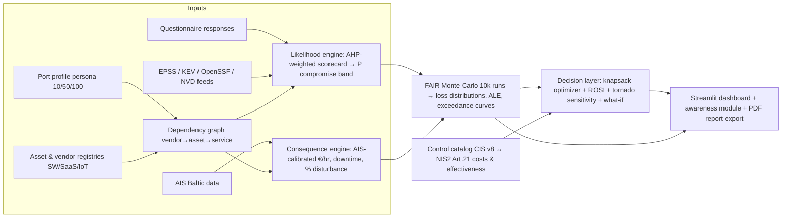

# Supply-Chain Cyber Risk DSS for Small EU Ports — Project Plan & Direction Analysis

*Drafted 2026-07-27. Status: plan proposed, direction pending team/teacher confirmation.*

---

## 0. TL;DR — Recommended direction

Build a **quantitative, prescriptive supply-chain cyber-risk DSS for small EU ports** (working name: **PortSCRA** — Port Supply-Chain Risk Analyzer) that:

1. **Models the port as a dependency graph** — vendors → assets (software / SaaS / IoT-OT) → port services (vessel handling, gate ops, billing…) — using the ENISA port asset taxonomy.
2. **Scores vendor compromise likelihood** with a hybrid evidence model: a NIS2-mapped questionnaire (AHP-weighted criteria — the teacher offered to help with exactly this) fused with **live public signals** (EPSS exploit probabilities, CISA KEV, OpenSSF Scorecard for freeware, breach history).
3. **Quantifies consequences the way Problem #2 literally asks** — revenue fall in €, downtime hours, operations disturbance % — via **FAIR-style Monte Carlo simulation**, with loss magnitudes **calibrated from the provided Baltic AIS data** (traffic → throughput → €/hour proxies) and anchored to real port incidents (Maersk/NotPetya, Port of Nagoya, DP World).
4. **Answers Problem #1 prescriptively**: an optimizer (0/1 knapsack over a CIS-Controls-mapped control catalog) that selects the **best mitigation portfolio under a budget constraint**, with ROSI, sensitivity (tornado) analysis, and what-if sliders.
5. Ships as a **Streamlit app** (the team's proven stack) with an integrated **risk-driven awareness module** (NIS2 Art. 20 training obligation tie-in).

Why this wins: every free tool out there (CSET, MONARC, SimpleRisk) stops at a qualitative heat map; commercial platforms (BitSight, SecurityScorecard) are black-box, enterprise-priced, and port-blind. Nobody combines vendor-likelihood modeling + port-specific AIS-calibrated consequence quantification + budget-constrained mitigation optimization in an open tool a 10–100-employee port can actually use. And methodologically it beats the football project on precisely the dimensions a DSS course grades: uncertainty handling, true multi-criteria decision layer, optimization under constraints, sensitivity analysis, and explainability.

---

## 0.1 Decisions update (2026-07-29)

Context changed from the original assignment framing — **this is now a solo, ungraded portfolio project for GitHub**. Consequences:

1. **No teacher/TA, no team** → §8's questions are moot. The AHP expert-elicitation session is replaced by: literature-derived default weights + **in-app AHP pairwise-comparison UI** so any user can supply their own weights (consistency-ratio checked). This turns a lost resource into a product feature.
2. **Persona anchor locked: 100-employee, mixed-traffic port** (RoRo/ferry + bulk + container feeder). The 10/50 personas stay as app presets but calibration targets the 100-mixed case.
3. **Dataset locked: Danish Maritime Authority free AIS** (`aisdata.ais.dk` → S3 bucket in eu-central-1). Verified 2026-07-29 against the live bucket:
   - Root: **515 daily `aisdk-YYYY-MM-DD.zip` files, 2025-02-27 → 2026-07-26** (current to ~3 days ago), ~550–750 MB each zipped (~25M rows/day, all Danish waters).
   - Archive: year folders **2006–2024**, holding *both* monthly bundles (`2024/aisdk-2024-01.zip`, ~16–18 GB) and daily files (`2024/aisdk-2024-03-01.zip`, ~550–750 MB). Daily granularity is available throughout — no need to touch the monthly bundles.
   - All 26 documented columns present. Ones we use: Timestamp (dayfirst `31/12/2015 23:59:59`), MMSI, Lat/Lon, SOG, Navigational status, Ship type, Cargo type, Length, Width, Draught, Destination, ETA.
4. **Coverage constraint → anchor port must be Danish** (DMA receivers cover Danish waters; the earlier Karlskrona/Karlshamn idea is dropped — Swedish ports are outside reliable coverage). **Anchor locked: Rønne, Bornholm.** Confirmed profile: >3,000 ship calls/yr, >1.4 Mt cargo, ~1.5 M passengers, ~345 k cars; ferry routes to Ystad (SE), Køge (DK), Sassnitz (DE), Świnoujście (PL); plus cruise calls and offshore-wind staging (Krigers Flak, Baltic Eagle, Arcadis Ost 1); TEN-T Comprehensive port. Three reasons it beats the alternatives: (a) genuinely *mixed* traffic — the persona choice is empirically defensible from Ship type/Cargo type rather than asserted; (b) it sits **in the Baltic**, satisfying the brief's "Baltic Sea Region" framing; (c) it is an **island port**, so a cyber outage severs Bornholm's supply line — a sharper, more honest consequence narrative than a mainland port with road alternatives. Port of Rønne A/S publishes annual accounts (public via CVR) for €-per-call calibration. Note: the port *company* employs well under 100 — frame the persona as the port **ecosystem** (port company + terminal ops + agents + service providers sharing the IT/OT estate). Fallbacks if first-day data disappoints: Grenaa, Kalundborg, Køge.
5. **AIS ETL plan**: download **1 day first** to build and validate the pipeline (also confirms Bornholm receiver coverage before committing); then scale to 4 representative weeks across seasons (~28 files ≈ 17 GB — stream zip → bbox filter to the Rønne polygon → parquet port-call table, discard raw). Port-call detection: vessel inside port polygon with SOG < 1 kn sustained ≥ 1 h, or Navigational status = "Moored"; record arrival/departure/dwell/type/size. Parsing gotchas to check on file #1: dayfirst timestamps, and the readme's decimal-comma convention (verify field separator). Tooling: polars or duckdb for raw scans, not plain pandas.
5b. **What AIS buys us, column by column** — Timestamp → port-call arrival/departure → **dwell hours** (the downtime denominator); Lat/Lon + SOG + Nav status → port-call detection; Ship type + Cargo type → **empirical proof of the "mixed" persona** (ferry/cargo/tanker/cruise split); Length/Width/Draught → vessel size → cargo-capacity proxy for €-per-call weighting; **Destination + ETA vs. actual arrival → a baseline distribution of schedule slippage.** That last one is the methodological gem: it lets "**operations disturbance in %**" — which the brief asks for by name — be defined rigorously as a *shift in the observed schedule-adherence distribution* under an incident, instead of an invented percentage. **Known gap: AIS carries no money and no tonnage/TEU.** €-per-call must come from Port of Rønne annual accounts + published tariffs, documented as an explicit assumption in the methodology.
5c. **Dataset comparison — DMA vs. Kaggle/Visky Tallinn (evaluated 2026-07-29).** Candidate: [`gaborvisky/ais-dataset`](https://www.kaggle.com/datasets/gaborvisky/ais-dataset) — "6-month long AIS data recorded near by port of Tallinn", by **Gábor Visky (TalTech)**, Apache 2.0, v1 last updated 2024-03-31, 287 downloads, no notebooks. Verified via Kaggle API: **3.58 GB compressed / 20.4 GB uncompressed**. Author's stated purpose: real-environment AIS for **anomaly/spoofing-detection research** ("validation is often missing or based on synthetic data").

| | **DMA (`aisdata.ais.dk`)** | **Kaggle / Visky (Tallinn)** |
|---|---|---|
| Provenance | Danish Maritime Authority (national authority) | TalTech research group (academic, citable) |
| Purpose built for | General maritime traffic monitoring | AIS anomaly/spoofing detection |
| Period | 2006 → present, current to ~3 days | 6 months, ends ~Mar 2024, static v1 |
| Coverage | All Danish waters, national receiver network | Single locality near one port |
| Schema | **26 columns, officially documented** | **Undocumented — unknown until download** |
| Format | Decoded CSV | Probably raw NMEA/VDL *(inferred, unverified)* |
| Access | Direct HTTP, no login | Kaggle account + API token |
| Volume | ~600 MB/day zipped, pick any days | 3.58 GB fixed download |
| Anchor port it implies | **Rønne — small, mixed** | **Tallinn — one of the Baltic's largest** |

**Decision: DMA stays primary. Three reasons, in order of weight.**
1. **Tallinn breaks the persona — decisive.** Port of Tallinn: ~29.8 Mt cargo/yr, 2M+ TEU, 7.75–10.6 M passengers/yr, 265 employees, five harbours, 25 berths in Old City Harbour alone. That is ~21× Rønne's tonnage and ~5× its passengers. The entire project premise is *small* EU ports with no security team and a NIS2-shaped, budget-starved decision maker — a port that size has a security function and doesn't need this DSS. Rønne fits the 100-person persona; Tallinn contradicts it.
2. **Schema risk + probable format mismatch.** No data dictionary is published, so the schema is unknowable without a 3.58 GB authenticated download. The size itself is a warning: 20.4 GB uncompressed for *one port over six months* is far denser than DMA's ~600 MB/day for *all Danish waters*, which points to message-level raw NMEA with signal metadata (consistent with Visky's published work on transmission-timing and signal features) rather than decoded position reports. If so, we'd have to write an AIS decoder (pyais/libais) before extracting a single port call — pipeline work that buys us nothing for consequence calibration. **Flagged as inference, not fact: verify by inspecting the archive listing before any use.**
3. **Temporal flexibility and freshness.** DMA offers 20 years and is current to ~3 days ago, so seasonality sampling is a processing-budget choice, not a data limit; Visky is a frozen 2024 snapshot.

**Where the Visky dataset is genuinely valuable to us — keep it, for two specific jobs:**
- **Citation asset for scenario S5 (AIS/GNSS spoofing).** Visky's PhD thesis *Cybersecurity for Maritime Operational Technology* (TalTech, defence Oct 2025) and his AIS spoofing-detection papers (ILP-based spoofing learning; statistical feature selection for AIS anomaly detection, IEEE SAMI 2025; IEEE LCN 2024) are directly citable for the S5 threat model — value that is independent of using his data.
- **Optional S5 demonstration data.** It is, by the author's own framing, the publicly available *real-environment* AIS dataset for spoofing research. If S5 ever needs an empirical demo rather than a modelled likelihood, this is the dataset to reach for. Backlog item, not core path.

Also evaluated and rejected: [AegeaNET Syros AIS](https://zenodo.org/records/18926663) (Univ. of the Aegean, Jul–Sep 2024, 170 MB, well documented with a description PDF) — clean and citable, but Aegean coverage, so it breaks the Baltic framing.

6. **Scope reshaped for solo build** — vertical slice first: 100-mixed persona, ~10 vendors, 7 scenarios, full pipeline (inventory → likelihood → consequence → Monte Carlo → optimizer → dashboard). **Backlog (build only after the slice works end-to-end):** awareness module, SimPy outage simulation, 10/50 persona calibration, SBOM ingestion.
7. **Portfolio-grade deliverable standards**: README as the report (architecture diagram, methodology, screenshots), reproducible pipeline (scripts + one bundled sample-day extract so others can run without the 17 GB download), tests on the Monte Carlo core and optimizer, deployed demo on HF Spaces.

---

## 1. Understanding the problem (decision-theoretic framing)

### 1.1 Who decides, and under what pressure
The decision maker is a small EU port's harbour master / IT manager / "CISO-of-one" (10–100 employees — no security team). Context that makes the decision real:

- **NIS2 (Directive (EU) 2022/2555)** — transposition deadline was Oct 2024. Ports (managing bodies of ports, port facilities) are an Annex I "Transport – Water" sector. Large entities are *essential*; medium-sized (50–249 employees) are *important*; smaller ports can still be designated in scope by member states (e.g., sole regional provider). Art. 21(2)(d) makes **supply-chain security** an explicit legal obligation; Art. 20 puts liability and training duties on management. Art. 23 imposes 24h/72h incident reporting.
- **Supply-chain attacks are the modern default**: SolarWinds (trojanized Orion updates → ~18,000 orgs), Kaseya 2021 (MSP → ransomware at ~1,500 downstream SMEs), MOVEit 2023 (vendor file-transfer software → 2,700+ orgs), 3CX 2023, xz-utils backdoor 2024 (CVE-2024-3094 — the canonical "freeware?" case). ENISA's Threat Landscape for Supply Chain Attacks found ~66% of supply-chain attacks target the supplier's code. Verizon DBIR 2025 reported third-party involvement in breaches roughly doubled year-over-year (~30%).
- **Ports get hit and it costs real money**: Maersk/NotPetya 2017 (~$250–300M, 76 terminals halted, ~10 days of IT rebuild); Port of Nagoya 2023 (LockBit 3.0 via ransomware — container ops down ~2.5 days); DP World Australia Nov 2023 (~3 days, ~30,000 containers stranded); COSCO 2018 (Americas network ~5 days); Port of Lisbon 2022 (LockBit); Port of Antwerp 2011–2013 (attackers manipulated container release systems for drug smuggling); a 2026 Anubis ransomware attack on an Adriatic port authority. These incidents are our consequence-model calibration anchors.

### 1.2 The two problems, restated as DSS problems
- **Problem #2 (estimation engine)**: Given P(vendor compromised), estimate the distribution of business impact: € revenue loss, downtime hours, % operations disturbance. This is a **risk quantification** problem: vendor → assets touched → services degraded → economic loss. The AIS data is the key to making loss magnitudes port-specific instead of generic.
- **Problem #1 (choice)**: Given quantified vendor risks and a budget, choose security tools/techniques/procedures. This is **portfolio selection under constraint** — a prescriptive optimization problem, not just a ranking.
- The four "DSS tasks" in the brief (security requirements for vendors/assets, risk metrics & process framework, awareness tool, risk dashboard) map 1:1 onto **ENISA's four-phase port cyber risk management approach** (2020): (1) identify cyber-related assets & services, (2) identify & evaluate risks, (3) identify security measures, (4) assess maturity. **Our DSS is the computational operationalization of that ENISA guidance for ports too small to do it manually.** That's the one-line "practical contribution" for the report.

### 1.3 Stakeholders (for the context diagram, mirroring the football report's §1.3)
Port authority management (budget owner, NIS2-liable) · IT/ops manager (system owner, availability-first) · Terminal/berth operators (uptime over security friction) · Software/SaaS/OT vendors + MSP (assessed parties; info asymmetry) · Shipping lines & agents (customers; schedule risk) · National cyber authority / CSIRT (NIS2 supervisor; e.g., Sweden's MSB) · Insurers (premiums reflect posture) · Customs/border agencies. Conflicts: uptime vs. security friction; compliance cost vs. thin margins; vendor lock-in vs. security requirements; disclosure vs. reputation.

### 1.4 Inputs (from the brief → how we use them)
| Brief input | Use in DSS |
|---|---|
| Employees: 10 / 50 / 100 | Three **port personas** scaling asset counts, control costs (CIS IG1→IG2), NIS2 scoping, loss magnitudes |
| Specific/unknown software (freeware?) | Software registry; CVE/EPSS/KEV lookup when known; **OpenSSF Scorecard** & conservative priors when freeware/unknown |
| SaaS / cloud accounts | SaaS registry (M365, booking, HR…); account-takeover & data-breach scenarios |
| Industrial assets (IoT devices) | OT/IoT registry (cranes, gate/ANPR, CCTV, sensors); IEC 62443-flavored checks; ops-halt scenarios |
| AIS Baltic Sea, complete set | **Consequence calibration**: vessel calls/day, dwell times, seasonality → throughput & €/hour proxies per persona; also enables an AIS/GNSS-spoofing scenario |
| "Something else…?" | EPSS & KEV feeds, NVD/OSV, ENISA threat taxonomy, incident base rates (DBIR, ENISA TL), CIS Controls cost/effort data, port annual reports (e.g., Karlshamn/Karlskrona — local BTH flavor) |

---

## 2. The bar to clear: football IDSS retrospective

**What it did well (reuse these moves):** clean academic structure (stakeholders → constraints → RQs → architecture → results → case study → limitations); dual-model separation of concerns; large dataset; deployed Streamlit/HuggingFace prototype; concrete case study; honest limitations.

**Where it is beatable (an examiner's view):**
1. **Thin decision layer** — filtering + ranked tables + a performance/price ratio. No explicit MCDM weighting, no optimization under the budget constraint it itself names (RQ1), no trade-off surface.
2. **Point estimates, zero uncertainty** — R²=0.97/0.89 but no confidence intervals, no sensitivity analysis; a DSS course cares about decisions under uncertainty.
3. **Proxy data** — FIFA video-game ratings, static snapshot (admitted in §7.3).
4. **Explainability gap** — admitted; SHAP/LIME deferred to future work.
5. **No baseline comparison** — no evidence the DSS decides better than a naive alternative.

**How the cyber project answers each, by design:** (1) AHP + knapsack optimization + what-if; (2) Monte Carlo distributions, P10/P50/P90, loss-exceedance curves, tornado sensitivity; (3) real regulatory context (NIS2), real incident calibration, real AIS data, live vuln feeds; (4) FAIR's factor tree is **transparent by construction** — every € number decomposes into inspectable factors; (5) we evaluate **against a 5×5 qualitative matrix baseline** and show where decisions differ and why.

---

## 3. Solution landscape (what exists today)

### 3.1 Commercial TPRM / security-ratings platforms
**BitSight, SecurityScorecard, UpGuard, Panorays, Prevalent, OneTrust, ProcessUnity, Venminder, Black Kite.** Outside-in scanning → letter-grade vendor scores, questionnaire automation, continuous monitoring. UpGuard targets mid-market; BitSight/SecurityScorecard are enterprise. **Black Kite is the honest nuance**: it does FAIR-based financial-impact quantification — proof the direction is industry-validated — but it's proprietary, enterprise-priced, and generic.
**Gaps for our user:** cost (tens of k€/yr), black-box scoring (unexplainable to a regulator), no port/OT context, no consequence model in the *port's* business terms, descriptive not prescriptive (no "given €20k, buy these five controls").

### 3.2 Free / open tools
- **CISA CSET** — free desktop tool; checklist assessments against NIST CSF, NIST SP 800-161 (supply chain), etc.; gap dashboards. Qualitative, no vendor-specific likelihood, no €, no optimization.
- **MONARC** (Luxembourg NC3/CASES) — open-source ISO 27005-aligned risk platform with asset/threat/vulnerability libraries. Qualitative matrices; risk register output; no supply-chain focus, no quantification, no decision optimization.
- **SimpleRisk, eramba** — open GRC/risk registers. Same ceiling: heat maps, not decisions.
- **Questionnaire standards** — Shared Assessments **SIG**, CSA **CAIQ**, NIST 800-161 appendices: content mines for our questionnaire, not tools.

**The pattern: every accessible tool stops at a qualitative risk register.** None quantify in €/hours/%, none know what a port is, none optimize under budget. That's the gap.

### 3.3 Methodologies (the toolbox to choose from)
- **Qualitative**: ISO 27005 matrices, OCTAVE Allegro, EBIOS RM. Familiar but ordinal-arithmetic is formally unsound (Cox 2008, *What's Wrong with Risk Matrices?* — ranking reversals, range compression).
- **Quantitative**: **FAIR / Open FAIR** (The Open Group O-RT/O-RA standards; `pyfair` Python implementation; Hubbard & Seiersen's *How to Measure Anything in Cybersecurity Risk* for calibrated-estimate Monte Carlo); Bayesian networks; attack trees/graphs; Gordon–Loeb model for optimal security investment level (elegant economics garnish: optimal spend ≤ 1/e of expected loss).
- **Vulnerability intelligence**: CVSS (severity) vs **EPSS** (P(exploitation within 30 days), free daily API from FIRST) vs **CISA KEV** (known-exploited catalog); **OpenSSF Scorecard** (automated OSS hygiene score — the "freeware?" answer); SBOM (CycloneDX/SPDX) as stretch.
- **Maritime-specific**: **ENISA Port Cybersecurity (2019)** — port asset & threat taxonomy + attack scenarios (our domain skeleton); **ENISA Cyber Risk Management for Ports (2020)** — the 4-phase approach mapped to ISPS Code (our process skeleton); IMO MSC.428(98) & MSC-FAL.1/Circ.3; BIMCO guidelines; IACS UR E26/E27 (ships).
- **Academic**: **MaCRA** (Tam & Jones 2019, Plymouth) — model-based maritime cyber risk, ship/voyage-centric, no supply chain, no economics; recent AHP+FMEA+Bayesian hybrids for maritime infrastructure; an optimization-based economic-loss estimation paper for port cyber-attacks (Transportation Research Part C) — validates our consequence direction; EU research line (e.g., H2020 CYRENE on supply-chain security assessment). **Research gap we fill**: no published work combines supply-chain (vendor) likelihood modeling + port-specific consequence quantification + prescriptive mitigation optimization in a deployable DSS for small ports.

---

## 4. Design alternatives — the decision axes (pros / cons / verdict)

### Axis 1 — Risk engine (the heart of the project)
| Option | Pros | Cons |
|---|---|---|
| **A. Qualitative 5×5 matrix** (ISO 27005 style, what CSET/MONARC do) | Fast; familiar; low data needs | **Cannot answer Problem #2's €/hours/% at all**; ordinal math formally unsound (Cox 2008); no uncertainty; zero novelty |
| **B. FAIR-style Monte Carlo (quantitative)** ✅ | Outputs are literally the asked metrics (€, hours, %); honest uncertainty (P10/P50/P90, loss-exceedance curves); transparent factor tree = built-in explainability; open standard + `pyfair` exists; calibratable from incidents/AIS | Needs input estimates (mitigated: PERT ranges, documented sources, teacher's metric help); more build effort; "where do priors come from?" must be answered in writing |
| **C. Bayesian network / attack graph** | Elegant propagation modeling (SolarWinds cascades); academically shiny | CPT parameterization is guesswork at this scale; heavy to build & explain; risk of eating the project |

**Verdict: B as the core.** Steal C's *structure* — the vendor→asset→service dependency graph — without full BN machinery (a simple noisy-OR propagation layer is an optional stretch). Keep A alive **as the evaluation baseline to beat** (§7).

### Axis 2 — Vendor compromise likelihood
| Option | Pros | Cons |
|---|---|---|
| A. Questionnaire only (SIG-lite / NIS2 Art. 21-mapped) | Works for any vendor; standard practice; teacher can help rank criteria | Self-reported, subjective, static |
| B. External signals only (EPSS/KEV on product CVEs, OpenSSF for freeware, breach history, TLS/DNS hygiene) | Objective, dynamic, free APIs; directly handles "unknown software / freeware" | Coverage gaps for niche vendors; outside-in ≠ ground truth |
| **C. Hybrid weighted scorecard** ✅ | Questionnaire sets a base rate via **AHP-weighted criteria** (uses the offered teacher/TA session as a real expert-elicitation exercise — methodological gold); external signals adjust it; "unknown vendor" degrades gracefully to conservative priors | Fusion logic must be documented carefully |

**Verdict: C.** Output is a calibrated probability band (e.g., P(compromise)/yr ∈ [2%, 8%], PERT-distributed), not a false-precision point.

### Axis 3 — Consequence model (Problem #2's engine)
| Option | Pros | Cons |
|---|---|---|
| A. Generic benchmarks (IBM Cost of a Data Breach, Ponemon per-employee) | Trivial | Ignores port ops *and* the provided AIS data; generic = forgettable |
| **B. AIS-calibrated analytic port model** ✅ | Uses the provided dataset meaningfully: vessel calls/day, dwell, seasonality → throughput → €/hour proxies per persona; service-outage → downtime hours → % disturbance → €; feeds FAIR's loss-magnitude leg; port-specific and defensible | Revenue proxying needs documented assumptions (calibrate against public port annual reports, e.g., Karlshamn/Karlskrona) |
| C. Full discrete-event SimPy simulation (outage injection → queueing/backlog recovery) | Team already has SimPy skill (Ro-Ro DSS); captures the non-linear truth that a 48h outage ≠ 48h of loss (queues, diversions, recovery tail); spectacular demo | A project in itself; validation burden; scope risk |

**Verdict: B as core, C as a bounded stretch** for one flagship scenario (Nagoya-style TOS ransomware, 48h) — the wow factor without betting the project on it.

### Axis 4 — Decision layer (Problem #1)
| Option | Pros | Cons |
|---|---|---|
| A. MCDM ranking only (AHP → TOPSIS over controls) | Classic, defensible, familiar from lit review | Ranks; doesn't **select a portfolio under budget**; ignores that one control covers many risks |
| B. Optimization only (0/1 knapsack: max Σ risk-reduction s.t. budget) | Literally "make key decisions"; pairs perfectly with FAIR (ΔALE per € per control); ROSI framing | Needs control-effectiveness estimates; opaque alone |
| **C. Hybrid prescriptive stack** ✅ | AHP for stakeholder weights → control×risk coverage matrix (CIS Controls v8 IG1/IG2 mapped to NIS2 Art. 21) → knapsack ILP (PuLP) → **tornado sensitivity + what-if sliders** | Most work — but it *is* the differentiator |

**Verdict: C.** Personas scale the catalog naturally: 10-employee port → CIS IG1 (essential cyber hygiene, 56 safeguards); 50–100 → IG1+IG2 subset.

### Axis 5 — Framework grounding
ISO 27005/27036 (paywalled) vs NIST CSF 2.0 + SP 800-161 (free, US-flavored) vs **NIS2 + ENISA port taxonomy (EU, free, legally binding for the user)**.
**Verdict:** NIS2 Art. 21 + ENISA port asset/threat taxonomy as the domain skeleton; cross-map controls to NIST CSF 2.0 functions + CIS Controls v8 for the catalog. All free, all citable, and the EU grounding fits the assignment's framing ("small ports in EU").

### Axis 6 — Platform
Streamlit + HuggingFace Spaces (team-proven, free, fast) vs Dash vs React+FastAPI.
**Verdict: Streamlit.** Stack: `pandas`/`numpy`/`scipy` (distributions), own ~100-line Monte Carlo core (full control + transparency; `pyfair` as cross-validation), `networkx` (dependency graph), `PuLP` (knapsack ILP), `plotly` (loss-exceedance, tornado), `streamlit`. No deep learning needed — and that's a *feature*: the model is explainable end-to-end (contrast with football project's admitted black-box gap).

### Axis 7 — Awareness module (keep it small but smart)
Static quiz vs **risk-driven scenario vignettes** ✅: generate awareness content from the port's *own* computed top-N risks (e.g., "your MSP has admin access to everything — here's the Kaseya story"), score understanding, tie to NIS2 Art. 20 management-training duty. Personalization is the differentiator; a generic quiz is filler.

---

## 5. Recommended architecture

### 5.1 Scenario catalog (Problem "assess most possible risk scenarios")

| ID | Scenario | Incident anchor | ENISA threat category | MITRE ATT&CK |
|---|---|---|---|---|
| S1 | Trojanized software update of TOS/PCS | SolarWinds 2020 | Targeted attacks / malware | T1195.002 (software supply chain) |
| S2 | MSP compromise → ransomware | Kaseya 2021; Nagoya 2023 | Malware / denial of service | T1199 (trusted relationship), T1486 (ransomware) |
| S3 | SaaS account takeover → BEC / invoice fraud | M365 BEC wave | Social engineering / identity theft | T1078 (valid accounts), T1114 (email collection) |
| S4 | IoT/OT compromise — cranes, gates, CCTV | Antwerp 2011–13 (container-release manipulation) | Data manipulation | ATT&CK for ICS T0862 (supply chain compromise) |
| S5 | AIS/GNSS spoofing — navigation data manipulation | Documented Baltic GPS jamming | Geo-localisation signal spoofing/jamming | ICS T0856 (spoof reporting message, nearest analogue) |
| S6 | Compromised freeware / OSS dependency | xz-utils backdoor 2024 (CVE-2024-3094) | Vulnerability exploitation | T1195.001 (software dependencies) |
| S7 | Vendor data breach → credential/manifest exposure | MOVEit 2023 | Abuse & theft of data | T1190 (exploit public-facing application) |

### 5.2 Threat-modeling layer (how the catalog is built and audited)

Positioning (defense-ready formulation): **threat identification = ENISA port threat taxonomy (domain skeleton) × MITRE ATT&CK techniques (concrete vectors) × STRIDE (completeness audit) — feeding FAIR quantification and the mitigation optimizer.** The DSS as a whole answers Shostack's four threat-modeling questions: *what are we working on* (dependency graph), *what can go wrong* (scenario catalog + Monte Carlo), *what will we do about it* (optimizer), *did we do a good job* (validation phase §7).

- **STRIDE's role — completeness audit only.** For each asset class, check that scenarios cover the applicable letters: Spoofing → S5/phishing; Tampering → S1/S4; Repudiation → weak vendor audit logging (can't prove who released a container); Information disclosure → S7; DoS → S2; Elevation of privilege → MSP admin abuse in S2. STRIDE cannot be the primary framework: it is software-design-centric (assumes a DFD of *your own* system), enumerates categories without likelihood/consequence, and its scoring companion DREAD is deprecated — FAIR does that job properly.
- **ATT&CK's role — concreteness + control mapping.** Technique tags (table above) make scenarios auditable and later justify the optimizer's control×risk coverage matrix via ATT&CK's published mitigation mappings (e.g., M1051 Update Software, M1032 MFA).
- **PASTA — the cited philosophy.** Our pipeline follows PASTA's risk-centric approach (seven stages ending in business-impact analysis) rather than STRIDE's software-centric one; one paragraph in the report positions this against threat-modeling literature.
- **Bow-tie diagrams — the visualization.** Causes → scenario → consequences with controls drawn as barriers; native to ports' ISPS/safety culture, ideal for the dashboard and report figures showing *where* a purchased control interrupts each scenario.
- **Explicitly excluded:** DREAD (superseded by FAIR), LINDDUN (privacy threat modeling — out of scope).

---

## 6. Phase plan (≈7 weeks, 3 people)

| Phase | Weeks | Deliverables | Lead hook |
|---|---|---|---|
| **0. Foundation & scoping** | 1 | Teacher Q&A (see §8); corpus collected (ENISA taxonomies, NIS2 text, CIS v8, EPSS/KEV, AIS extract); repo + report skeleton | all |
| **1. Domain model & data** | 1–2 | Asset/service/vendor schemas; dependency graph; 3 personas; scenario catalog (ENISA × ATT&CK, STRIDE-audited, §5.1–5.2); AIS pipeline → traffic & €/hr baselines per persona | member A |
| **2. Likelihood engine** | 2–3 | NIS2-mapped questionnaire (~20 Qs); signal ingestion (EPSS/KEV/OpenSSF); **AHP session with TA as expert panel**; calibrated probability bands | member B |
| **3. Consequence engine** | 3–4 | Service-outage → hours/%/€ model; incident anchors (Nagoya 2.5d, DP World ~3d, Maersk tail); Monte Carlo core; loss-exceedance curves | member A |
| **4. Decision layer** | 4–5 | Control catalog w/ costs (persona-scaled); coverage matrix; knapsack + ROSI; tornado sensitivity; what-if | member C |
| **5. DSS app** | 5–6 | Streamlit multi-page: Inventory · Vendor assessment · Risk dashboard · Optimizer · Awareness · Report export; HF Spaces deploy | member C |
| **6. Validation & report** | 6–7 | Case studies: (a) SolarWinds-replay on TOS vendor, (b) Nagoya-style ransomware w/ optional SimPy run, (c) 10/50/100 persona sweep; **baseline duel vs 5×5 matrix**; sensitivity analysis; report in football-report structure | all |

Project risk register (meta, examiners like it): scope creep on SimPy stretch (timebox to 1 scenario); estimate defensibility (every prior documented with source); AIS processing surprises (start week 1); freeware data gaps (conservative priors by design).

## 7. Validation & evaluation plan (the football report had none — this is a big differentiator)
1. **Scenario replays**: run the S1/S2 scenarios and compare model outputs against the real incident envelopes (Nagoya ~2.5 days, Maersk as tail case). Model credible ⇔ real incidents fall inside predicted P10–P90.
2. **Baseline comparison**: same port, same vendors, assessed with a 5×5 qualitative matrix vs our engine → show concrete decision differences (e.g., matrix ties three vendors at "High" while quantitative model separates them by 8× in expected loss; optimizer picks a different portfolio than "fix the reddest cell first").
3. **Sensitivity analysis**: tornado charts per scenario — which inputs move the answer; robustness of the chosen portfolio across ±50% input perturbation.
4. **Persona sweep**: 10/50/100 employees → does recommended portfolio scale sensibly (IG1 → IG1+IG2)? Face validity check with TA.

## 8. Questions for teacher/TA (they offered: input data, criteria ranking, metrics)
1. AIS dataset: format/fields/period? Is deriving €/hour throughput proxies from it an acceptable consequence basis (supplemented by public port annual reports)?
2. Personas: are 10/50/100-employee ports meant as three test cases? Any preferred port type (RoRo / container / mixed — e.g., Karlskrona/Karlshamn as local anchors)?
3. Criteria ranking: can we run a short **AHP pairwise-comparison session with you as the expert panel** for vendor-risk criteria weights? (This turns "TA feedback" into documented expert elicitation.)
4. Metrics: confirm target definitions — annualized expected loss (€/yr) + per-incident P10/P50/P90, downtime hours, % throughput disturbance. Any required additions (e.g., recovery cost split)?
5. Scope check: is the quantitative FAIR + optimization direction aligned with grading expectations, or is a qualitative framework mandatory to include (we'd keep it as baseline)?

## 9. How this outshines the football project

| Dimension | Football IDSS | This project |
|---|---|---|
| Decision layer | Filter + ranked table + ratio | AHP weighting + knapsack optimization under budget + ROSI + what-if |
| Uncertainty | Point estimates | Monte Carlo distributions, P10/P50/P90, loss-exceedance curves |
| Sensitivity | None | Tornado charts, ±50% robustness sweep |
| Explainability | Admitted gap (deferred to SHAP) | FAIR factor tree — transparent by construction |
| Data | One static game dataset | AIS (real traffic) + EPSS/KEV/OpenSSF (live) + incident base rates + questionnaire |
| Real-world grounding | Proxy market | NIS2 legal obligations, ENISA taxonomies, real incidents as calibration |
| Validation | One illustrative case study | Incident replays + baseline duel + persona sweep + sensitivity |
| Prescriptiveness | "Here are undervalued players" | "Given €20k, install these 6 controls; here's the expected-loss delta" |

## 10. Sources
- ENISA, [Port Cybersecurity — Good practices (2019)](https://safety4sea.com/wp-content/uploads/2019/12/Enisa-Port-cybersecurity-2019_12.pdf) · [Cyber Risk Management for Ports (2020)](https://portalcip.org/wp-content/uploads/2024/11/ENISA-Guidelines-Cyber-Risk-Management-for-Ports.pdf) (local copy in `refs/`) · [ENISA port threat news](https://www.enisa.europa.eu/news/enisa-news/how-can-eu-ports-tackle-new-cyber-threats)
- NIS2: [Article 21 measures mapped](https://www.trout.software/blog/nis2-compliance-a-practical-guide-to-meeting-article-21-security-obligations) · [Supply chain requirements](https://www.cybertrust365.com/en/supply-chain-security-nis2/) · [NIS2 in maritime](https://e-wma.com/nis-2-directive-non-compliance/)
- Free tools: [CISA CSET](https://www.cisa.gov/resources-tools/services/cyber-security-evaluation-tool-csetr) ([GitHub](https://github.com/cisagov/cset)) · [MONARC](https://www.monarc.lu/publications/comparison-between-monarc-and-different-risk-management-methods/)
- Commercial landscape: [BitSight vs SecurityScorecard (UpGuard)](https://www.upguard.com/compare/bitsight-vs-securityscorecard) · [BitSight comparisons](https://www.bitsight.com/compare)
- FAIR: [FAIR overview](https://en.wikipedia.org/wiki/Factor_analysis_of_information_risk) · [pyfair](https://github.com/Hive-Systems/pyfair) · [pyfair docs](https://pyfair.readthedocs.io/)
- Vulnerability intel: [EPSS (FIRST)](https://www.first.org/epss/) · [EPSS data/API](https://www.first.org/epss/data_stats)
- Incidents: [Nagoya (Industrial Cyber)](https://industrialcyber.co/transport/operations-at-japans-port-of-nagoya-resume-after-probable-lockbit-ransomware-attack/) · [Nagoya context (gCaptain)](https://gcaptain.com/putting-the-port-of-nagoya-cyberattack-in-context/) · [Maersk $300M (The Register)](https://www.theregister.com/2017/08/16/notpetya_ransomware_attack_cost_us_300m_says_shipping_giant_maersk/) · [Dragos on Nagoya OT](https://www.dragos.com/blog/ot-cybersecurity-breach-disrupts-operations-at-the-port-of-nagoya-japan/) · [Adriatic port Anubis ransomware](https://www.resecurity.com/blog/article/the-anubis-ransomware-attack-on-the-adriatic-port-authority)
- Academic: [MaCRA (Springer)](https://link.springer.com/article/10.1007/s13437-019-00162-2) · [Economic losses from port cyber-attacks — optimization approach (ScienceDirect)](https://www.sciencedirect.com/science/article/abs/pii/S0968090X21004174) · [Maritime cybersecurity SLR](https://www.sciencedirect.com/science/article/pii/S1874548222000555)
- Threat modeling: [MITRE ATT&CK](https://attack.mitre.org/) (T1195 supply chain; ATT&CK for ICS) · Shostack, *Threat Modeling: Designing for Security* (Wiley, 2014 — the "four questions") · UcedaVélez & Morana, *Risk Centric Threat Modeling: PASTA* (Wiley, 2015) · Microsoft STRIDE (used as completeness audit only)
